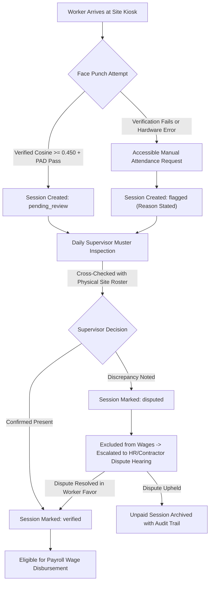

# BuildEase — Controlled Site Pilot Checklist & Field Trial Protocol

**Document Version:** 1.0.0  
**Target Environment:** Metro Elevated Corridor (Project Site 1 - Kiosk Gate 1)  
**Biometric Engine:** OpenCV YuNet (640×640 Detector) + OpenCV SFace (112×112 Recognizer, 128D Embedding) on ONNX Runtime CPU  
**Document Classification:** Confidential — Pilot Site Operations & Compliance  
**Last Updated:** October 14, 2026  

---

## 1. Pilot Governance, Ethical Mandates & Worker Protections

> [!IMPORTANT]
> **Cardinal Rule 1: Zero Wage Loss on Biometric Exceptions**  
> Under no circumstances shall a biometric verification failure, device timeout, camera glare, optical rejection, or template incompatibility directly result in wage deductions or unpaid labor. If biometric punch verification fails, the worker is immediately directed to the physical supervisor muster roll and the built-in accessible manual attendance workflow.

> [!IMPORTANT]
> **Cardinal Rule 2: Explicit Informed Consent (DPDP Act 2023 Compliance)**  
> Prior to registering any worker's facial embedding:
> 1. The worker must receive an explanation in their primary spoken language (English, Hindi, Marathi, Assamese, or Bengali) explaining:
>    - What is captured: A 128-dimensional mathematical vector extracted from facial contours.
>    - What is NOT stored: Raw video recordings or original biometric photos are not permanently stored on the device or server.
>    - Purpose: Strictly workforce attendance timestamping and wage muster calculation.
>    - Voluntariness: Enrollment is completely voluntary. Workers choosing not to enroll face templates are guaranteed full access to daily physical muster attendance without penalty.
> 2. The worker must execute affirmative digital consent (checked box on `FaceEnrollmentModal`) witnessed and digitally countersigned by the Site Supervisor.

---

## 2. Physical Kiosk Hardware & Environmental Setup Checklist

Before initiating participant trials, the Site Supervisor and Lead Field Engineer must verify every pre-flight environmental condition:

| Setup Item | Requirement | Verification Method | Status | Notes |
|---|---|---|---|---|
| **Mounting & Height** | Kiosk tablet/camera mounted at eye level: 145 cm – 165 cm from floor. | Tape measure inspection; adjustable tilt bracket operational. | **NOT RUN** | Pending on-site kiosk installation |
| **Participant Stand Distance** | Floor marking tape placed 50 cm – 75 cm from lens. | High-visibility yellow floor tape applied. | **NOT RUN** | Distance boundary demarcation |
| **Primary Lighting** | Diffuse frontal lighting: 250 – 500 lux across facial plane. | Digital lux meter measurement at 60 cm stand mark. | **NOT RUN** | Target 350 lux diffuse warm light |
| **Backlight Prevention** | No unshaded windows, sun glare, or halogen spotlights directly behind worker. | Visual inspection during dawn, noon, and twilight. | **NOT RUN** | Anti-backlight baffle curtain checked |
| **Camera Sensor & Lens** | Clean, fingerprint-free optical glass; autofocus locked to 50–80 cm; min 720p. | Optical inspection with lens wipe; test preview sharpness. | **NOT RUN** | 1080p UVC wide-angle USB camera |
| **Local Compute & Power** | Kiosk hardware connected to dedicated UPS/surge protector; CPU utilization < 60%. | Kiosk boot test; CPU temperature and power load verified. | **NOT RUN** | Windows/Linux edge terminal |
| **Site Network & Isolation** | Local LAN connection to site server; air-gap status checked if offline. | Ping test to backend; firewall rules verified. | **NOT RUN** | Port 3000 local intranet bound |
| **PPE Handling Guidance** | Clear visual poster illustrating PPE guidelines during face punch. | Signage posted: Hardhat permitted; pull down dust mask; lift tinted visors. | **NOT RUN** | Multilingual visual infographic posted |

---

## 3. Controlled Pilot Test Matrix

*All physical field tests in this matrix represent live trials to be executed on-site with consenting human volunteers. Per audit standards, tests that have not yet been physically executed in the field are explicitly marked as **NOT RUN**.*

### Category A: Worker Consent & Biometric Enrollment
| Test ID | Scenario | Preconditions | Target Subject | Expected System Behavior | Field Status | Observed Result | Tester Signoff |
|---|---|---|---|---|---|---|---|
| **PLT-A01** | First-Time Worker Enrollment with Signed Consent | Clean database; supervisor logged in; consenting worker. | Consenting Volunteer 1 (Mason) | YuNet detects 1 face with 5 landmarks; SFace extracts 128D vector; consent checkbox required; enrolled record saved with status `enrolled`. | **NOT RUN** | Pending physical pilot launch | — |
| **PLT-A02** | Enrollment Attempt with Missing Worker Consent | Kiosk enrollment modal open; worker present. | Consenting Volunteer 2 | Extract & Enroll button disabled until checkbox clicked. API `POST /api/biometrics/enroll` rejects with `400 WORKER_CONSENT_REQUIRED` if bypassed. | **NOT RUN** | Pending physical pilot launch | — |
| **PLT-A03** | Template Privacy Redaction Verification | Worker enrolled via kiosk. | Volunteer 1 | Querying `/api/biometrics/workers` returns public worker metadata; `biometricTemplate` object is completely stripped from payload. | **NOT RUN** | Pending physical pilot launch | — |

---

### Category B: Genuine Same-Person Attendance Punches
| Test ID | Scenario | Test Condition | Target Subject | Expected System Behavior | Field Status | Observed Result | Tester Signoff |
|---|---|---|---|---|---|---|---|
| **PLT-B01** | Morning CHECK_IN (Optimal Lighting) | 07:45 AM, 350 lux diffuse frontal lighting, neutral gaze, 60 cm distance. | Volunteer 1 | YuNet detects 1 face; SFace cosine similarity >= 0.750 (well above provisional 0.450); server UTC timestamp recorded; session created in `pending_review`. | **NOT RUN** | Pending physical pilot launch | — |
| **PLT-B02** | Minor Head Pitch/Yaw (+15° Angle) | Worker turned 10°–15° off-axis; normal lighting. | Volunteer 1 | YuNet landmark-guided affine warp normalizes pose; cosine similarity >= 0.600; punch accepted. | **NOT RUN** | Pending physical pilot launch | — |
| **PLT-B03** | Construction PPE: Hard Hat On | Standard safety helmet worn on head; brow visible. | Volunteer 1 | YuNet isolates facial bbox below helmet rim; landmarks localized; punch verified. | **NOT RUN** | Pending physical pilot launch | — |
| **PLT-B04** | Site Sweat / Minor Dust Profile | Worker after 4 hours of site shift; mild perspiration/dust. | Volunteer 1 | Landmark tracking stable; cosine similarity >= 0.550; punch accepted. | **NOT RUN** | Pending physical pilot launch | — |
| **PLT-B05** | Evening CHECK_OUT & Duration Calculation | 05:15 PM, worker punches checkout. | Volunteer 1 | Open session updated with checkout punch ID; duration and hours calculated; session status `completed`, review status `pending_review`. | **NOT RUN** | Pending physical pilot launch | — |

---

### Category C: Cross-Identity Impersonation & Buddy-Punch Prevention
| Test ID | Scenario | Test Condition | Target Subject | Expected System Behavior | Field Status | Observed Result | Tester Signoff |
|---|---|---|---|---|---|---|---|
| **PLT-C01** | Buddy Punch Attempt (Worker A ID, Worker B Face) | Worker A selected in kiosk; Worker B (different enrolled worker) stands in camera view. | Volunteer 2 standing as Volunteer 1 | SFace extracts Worker B's embedding; compares against Worker A's stored template; cosine similarity < 0.300; rejected with `FACE_MISMATCH`. No punch recorded. | **NOT RUN** | Pending physical pilot launch | — |
| **PLT-C02** | Unenrolled Impostor Attempt | Unenrolled site visitor stands in camera view under enrolled worker ID. | Unenrolled Volunteer 3 | Face recognized as non-matching; cosine similarity < 0.250; rejected with `FACE_MISMATCH`. Attempt logged in audit ledger. | **NOT RUN** | Pending physical pilot launch | — |

---

### Category D: Degraded, Obscured & Edge Environmental Frames
| Test ID | Scenario | Test Condition | Target Subject | Expected System Behavior | Field Status | Observed Result | Tester Signoff |
|---|---|---|---|---|---|---|---|
| **PLT-D01** | Zero Faces in Camera View | Camera lens covered, or worker looking entirely away. | Empty viewport | YuNet detects 0 faces; rejected with `NO_FACE_DETECTED`. Client prompts user to face camera. | **NOT RUN** | Pending physical pilot launch | — |
| **PLT-D02** | Multiple Workers in Camera Viewport | Two workers standing shoulder-to-shoulder in frame. | Volunteer 1 + Volunteer 2 | YuNet detects 2 faces (> 1); rejected with `MULTIPLE_FACES_DETECTED`. Client requests single worker in frame. | **NOT RUN** | Pending physical pilot launch | — |
| **PLT-D03** | Low Light / Night Shift (< 15 lux) | Overhead kiosk light turned off; dim site twilight. | Volunteer 1 | If contrast insufficient for confident landmark detection, fails safe with `NO_FACE_DETECTED`. Worker directed to manual muster. | **NOT RUN** | Pending physical pilot launch | — |
| **PLT-D04** | Direct Lens Glare / Washed-Out Sensor | Sunlight reflection or flashlight directed into lens. | Overexposed camera | High luminance saturation prevents false detection; safely rejected. No false acceptances. | **NOT RUN** | Pending physical pilot launch | — |
| **PLT-D05** | Rapid Motion / Severe Motion Blur | Worker walking quickly past camera while clicking punch. | Moving subject | Image decode succeeds; blurred features fail face confidence threshold; safely rejected. | **NOT RUN** | Pending physical pilot launch | — |

---

### Category E: Physical Anti-Spoofing & Presentation Attack Trials
| Test ID | Scenario | Test Condition | Target Subject | Expected System Behavior | Field Status | Observed Result | Tester Signoff |
|---|---|---|---|---|---|---|---|
| **PLT-E01** | High-Brightness Smartphone Screen Replay | Smartphone displaying high-res portrait of Volunteer 1 held 40 cm from lens. | OLED/LCD Screen | High-frequency moiré screen grid flagged by optical frequency analysis; rejected with `SPOOF_DETECTED_REPLAY_ATTACK`. | **NOT RUN** | Pending physical pilot launch | — |
| **PLT-E02** | Printed Color Photograph on Copy Paper | High-res color laser printout of Volunteer 1 held in front of face. | A4 Paper Photo | Flat planar reflectance / lack of depth variance flagged; rejected with `SPOOF_DETECTED_PAPER_ATTACK`. | **NOT RUN** | Pending physical pilot launch | — |
| **PLT-E03** | Anti-Spoof Boundary Audit (Matte Screen) | Matte laptop screen or e-ink display held in front of lens. | Matte Display | Level 1 Heuristics may not catch anti-glare screens; documented boundary. **Defense:** Mandatory supervisor muster review prevents wage exploitation. | **NOT RUN** | Pending physical pilot launch | — |

---

### Category F: Legacy Template Migration & Re-Enrollment
| Test ID | Scenario | Test Condition | Target Subject | Expected System Behavior | Field Status | Observed Result | Tester Signoff |
|---|---|---|---|---|---|---|---|
| **PLT-F01** | Legacy Worker Attendance Blockage | Worker `W-0418` (Rameshwar Yadav) with legacy synthetic template attempts punch. | Pre-existing Seed Worker | System blocks punch with `LEGACY_TEMPLATE_INCOMPATIBLE`; modal displays amber warning and "Re-enroll Face" button. | **NOT RUN** | Pending physical pilot launch | — |
| **PLT-F02** | Legacy Worker SFace Re-Enrollment Flow | Worker `W-0418` captured via real camera with signed consent. | Consenting Volunteer for W-0418 | Template updated to genuine SFace 128D; status updated to `enrolled`; `requiresReenrollment` cleared; subsequent punch succeeds. | **NOT RUN** | Pending physical pilot launch | — |

---

### Category G: Attendance State Transitions & Duplicate Protection
| Test ID | Scenario | Test Condition | Target Subject | Expected System Behavior | Field Status | Observed Result | Tester Signoff |
|---|---|---|---|---|---|---|---|
| **PLT-G01** | Rapid Duplicate CHECK_IN (< 5 min) | Worker punches CHECK_IN, then immediately attempts second CHECK_IN 30 seconds later. | Volunteer 1 | Rejected with `DUPLICATE_PUNCH: Worker already checked in (0.5 min ago). Rapid duplicate check-ins within 5 minutes are rejected.` | **NOT RUN** | Pending physical pilot launch | — |
| **PLT-G02** | Double CHECK_IN Anomaly (> 5 min) | Worker checked in morning, leaves site without checkout, returns and checks in again. | Volunteer 1 | Previous open session marked with `sessionStatus: 'flagged'` and anomaly note; supervisor review status set to `pending_review`. | **NOT RUN** | Pending physical pilot launch | — |
| **PLT-G03** | Orphan CHECK_OUT Anomaly | Worker punches CHECK_OUT without prior CHECK_IN session for today. | Volunteer 2 | Session created with `sessionStatus: 'flagged'`, `supervisorReviewStatus: 'disputed'`, and `ORPHAN_CHECK_OUT` audit flag. | **NOT RUN** | Pending physical pilot launch | — |

---

### Category H: Role-Based Authorization & Cross-Site Isolation
| Test ID | Scenario | Test Condition | Target Subject | Expected System Behavior | Field Status | Observed Result | Tester Signoff |
|---|---|---|---|---|---|---|---|
| **PLT-H01** | Worker Attempting Self-Approval | Worker authenticated user attempts `POST /api/biometrics/verify-session`. | Worker Role | Server returns HTTP 403 Forbidden (`UNAUTHORIZED_ROLE`). Worker cannot approve own hours. | **NOT RUN** | Pending physical pilot launch | — |
| **PLT-H02** | Supervisor Cross-Site Action Barrier | Supervisor assigned to Project Site 2 attempts to verify sessions on Project Site 1. | Supervisor 2 | Server returns HTTP 403 Forbidden (`CROSS_SITE_ACCESS_DENIED`). Record remains unmodified. | **NOT RUN** | Pending physical pilot launch | — |
| **PLT-H03** | Supervisor Cross-Site Enrollment Barrier | Supervisor assigned to Project Site 2 attempts to enroll worker for Project Site 1. | Supervisor 2 | Server returns HTTP 403 Forbidden (`CROSS_SITE_ACCESS_DENIED`). Enrollment blocked. | **NOT RUN** | Pending physical pilot launch | — |

---

### Category I: Supervisor Review, Manual Muster Exception & Payroll Wage Eligibility
| Test ID | Scenario | Test Condition | Target Subject | Expected System Behavior | Field Status | Observed Result | Tester Signoff |
|---|---|---|---|---|---|---|---|
| **PLT-I01** | Raw Punch Exclusion from Payroll | Worker completes valid face punch; session in `pending_review`. | Volunteer 1 | `/api/payroll/verified-muster` shows session in `excludedUnverifiedSessionsCount` and hours in `excludedHours`. 0 hours credited to wage muster. | **NOT RUN** | Pending physical pilot launch | — |
| **PLT-I02** | Accessible Manual Attendance Exception Request | Worker has eye bandage / camera glitch; clicks "Request Manual Attendance". | Injured / Camera-Shy Worker | Punch created with `verificationMethod: 'MANUAL_SUPERVISOR_REQUEST'`; session flagged; reason logged in audit trail. | **NOT RUN** | Pending physical pilot launch | — |
| **PLT-I03** | Supervisor Muster Reconciliation & Approval | Supervisor reviews physical attendance roll and clicks "Verify Attendance" on session. | Authorized Site Supervisor | Session status transitions to `verified`; `/api/payroll/verified-muster` now counts session in `verifiedHours` and includes in wage disbursement. | **NOT RUN** | Pending physical pilot launch | — |
| **PLT-I04** | Disputed Session Payroll Quarantine | Supervisor flags session with reason "Worker was absent from Pier 28 work site". | Disputed Worker | Session marked `disputed`; remains 100% excluded from payroll hours; dispute logged in immutable audit history. | **NOT RUN** | Pending physical pilot launch | — |

---

## 4. Safe Pilot Operation & Dispute Escalation Workflow

### Attendance Dispute & Error Correction Procedure:
1. **Notice of Discrepancy:** If a worker's session is flagged, rejected, or disputed, the worker is notified via their worker portal view on `/attendance` within 24 hours.
2. **Supervisor Muster Cross-Check:** The Site Supervisor inspects physical site logs (gate pass register, task gang cards, and team supervisor daily diaries).
3. **Muster Correction:** If physical presence is verified, the supervisor executes `/api/biometrics/verify-session` with sign-off notes, instantly transferring hours to payable status.
4. **Contractor Escalation:** If the dispute remains unresolved within 48 hours, it is escalated to the Contractor Project Manager for formal review before final payroll muster closure.

---

## 5. Biometric Data Privacy & Security Architecture

### A. Purpose Limitation & Proportionality
- Biometric data collection is restricted strictly to workforce identity verification for construction attendance.
- Templates are never repurposed for surveillance, worker tracking outside kiosk zones, or behavioral scoring.

### B. In-Memory Processing & Raw Image Non-Retention
- Webcam video frames captured as base64 data URLs are decoded in volatile heap memory, processed through YuNet and SFace ONNX inference engines, and immediately garbage-collected.
- **Raw camera images are NEVER written to disk** or stored in database files.

### C. Cryptographic Storage & Template Segregation
- The server stores only the 128-dimensional floating-point embedding vector, its cryptographic SHA-256 hash, and sampling resolution in `data/attendance_biometrics.json`.
- Biometric vectors cannot be reversed into original human facial photographs.
- The `biometricTemplate` property is private to the server and is stripped from all client-facing REST API endpoints.

### D. Cloud Transmission & External Service Disclosure
- **Default State (Local-Only):** When `GEMINI_API_KEY` is NOT configured, 100% of face detection, alignment, embedding extraction, matching, and Level 1 PAD runs locally on the edge server CPU. Zero bytes leave the local machine.
- **Optional Gemini Multimodal PAD:** If an administrator explicitly supplies `GEMINI_API_KEY`, the frame capture is sent over TLS/HTTPS to Google Gemini for presentation attack evaluation.
- **Audit Policy:** In strict air-gapped pilot deployments, `GEMINI_API_KEY` must remain unset.

### E. Template Retention & Right to Deletion
- Worker biometric templates are retained only for the duration of the worker's active employment on BuildEase project sites.
- Upon employment termination or consent revocation, the Site Supervisor or Admin executes biometric template deletion, purging the 128D embedding from active storage while preserving historical attendance punch timestamps.

---

## 6. Pilot Rollback & Emergency Kill-Switch Procedure

If unexpected biometric anomalies, model crashes, or hardware failures occur during the controlled site pilot:

1. **Software Kill-Switch (Instant Reversion to Manual Mode):**
   - In `AttendancePage.tsx`, the supervisor or contractor can switch kiosk mode to **"Manual Muster Mode"**, hiding facial verification and defaulting all punches to supervisor muster sign-offs.
2. **Database Rollback:**
   - Pre-pilot atomic backup snapshots are maintained at:
     - `data/attendance_biometrics.backup.json`
     - `data/attendance_biometrics.phase2.backup.json`
   - To restore pre-pilot state, stop the Node server, copy the backup file over `data/attendance_biometrics.json`, and restart.
3. **Threshold Adjustment:**
   - If acceptable workers experience high false rejections (FRR), adjust `BIOMETRIC_MATCH_THRESHOLD` in `.env` (e.g., from `0.450` to `0.420`) and restart server.
   - Do NOT lower below `0.350` to prevent cross-identity false acceptance (FAR).
