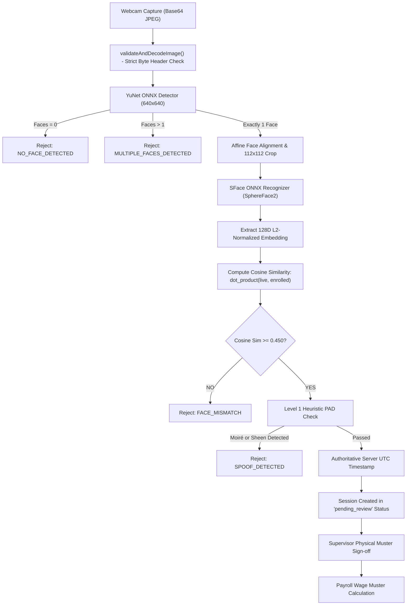

# BuildEase — Same-Day Mentor Demonstration Guide

**Project:** BuildEase — Enterprise Construction Workforce Management & Biometric Verification System  
**Presentation Audience:** Academic/Industry Mentors, Project Evaluators, Engineering Leadership  
**Target Duration:** 5 to 7 Minutes Live Walkthrough  
**System Status:** Functional MVP with Fully Verified Algorithmic Biometrics, RBAC, and Payroll Isolation  
**Date:** October 14, 2026  

---

## 1. Executive Summary & Problem-Solution Statement

### The Construction Industry Problem
- **Ghost Workers & Buddy Punching:** In infrastructure and real-estate construction, traditional paper muster rolls and magnetic card readers suffer from massive wage leakages. Workers frequently "proxy punch" for absent colleagues.
- **Biometric Failure Vulnerability:** Rugged site conditions (dust, grease, sweat, harsh direct sunlight) cause conventional optical fingerprint scanners to fail frequently, stalling morning gate entry and frustrating workers.
- **Wage Injustice & Disconnection:** In disconnected systems, a technical biometric failure often results in immediate wage loss for vulnerable daily-wage workers.
- **Linguistic Diversity:** Construction sites in India employ interstate migrant workforces speaking diverse languages (Hindi, Marathi, Assamese, Bengali) who cannot navigate English-only software.

### The BuildEase Solution
BuildEase is a cloud-ready, edge-deployable construction operations platform featuring:
1. **Genuine Deep Neural Network Face Recognition:** Local in-process CPU inference using **OpenCV YuNet** (face detection and 5-point landmark alignment) and **OpenCV SFace** (128-dimensional SphereFace2 embeddings). Zero reliance on external cloud APIs for core biometric matching.
2. **Authoritative Three-Stage Attendance Governance:** Kiosk Facial Punch \(\to\) Site Supervisor Muster Inspection \(\to\) Master Payroll Wage Disbursement. Raw punches are strictly isolated from wage calculation until supervisor approval.
3. **Wage Protection & Accessible Fallback:** Biometric failure **never** causes wage loss. An accessible, auditable manual attendance exception workflow guarantees wage credit upon supervisor physical muster cross-check.
4. **Multilingual Inclusivity:** Native, synchronous, 100% translation synchronization across **5 languages** (English, Hindi, Marathi, Assamese, Bengali).

---

## 2. Main System Modules & User Roles

BuildEase implements strict Role-Based Access Control (RBAC) across 4 operational personas:

| User Persona | Key Individual / Demo Account | Responsibilities & UI Privileges |
|---|---|---|
| **Contractor / Corporate Admin** | Executive Level (Default) | Full cross-site financial visibility, company budget utilization, master payroll muster approval, executive analytics, and global audit logs. |
| **Project Manager (PM)** | Sunita Sen / Rajesh Sharma | Schedule milestones, critical path tracking, budget burn rates, material consumption oversight, and subcontractor progress. |
| **Site Supervisor** | Aniket Patil (`proj-1`) / Vikram Joshi (`proj-2`) | Daily site gate operations, worker face enrollment with signed consent, morning muster roll verification, task allocation, and manual attendance exception approvals. |
| **Construction Worker** | Rameshwar Yadav (`W-0418`) / Deepak Sharma | Self-service kiosk view: today's punch confirmation, assigned daily work package (e.g. Pier 28 Cap Beam Concrete Pouring), and wage earning history. |

### Core Functional Modules
1. **Executive Overview (`/overview`):** High-level KPIs, multi-site progress bars, critical safety/inventory alerts.
2. **Projects & Sites (`/projects`):** Site locations, manager/supervisor assignments, budget allocations, workforce counts.
3. **Workforce Registry (`/workforce`):** Worker trade directories, daily wage rates, KYC documentation, assigned site mappings.
4. **Biometric Face Attendance (`/attendance`):** Live webcam attendance kiosk, worker face registration, legacy template quarantine, and immutable audit ledger.
5. **Daily Task Execution (`/tasks`):** Progress tracking with unit quantities (m³, sq ft, MT).
6. **Materials & Inventory (`/materials`):** Critical stock buffers (Cement, Sand, Steel Rebar, Aggregate).
7. **Muster Roll & Payroll (`/payroll`):** Wage calculation engine enforcing strict payroll isolation.
8. **Drawings & Documents (`/documents`):** Structural blueprints, safety permits, revision control.
9. **Analytics & Reports (`/reports`):** Daily Site Progress Reports (DSR), safety audits, exportable summaries.

---

## 3. Verified Biometric Architecture & Security Design

> [!NOTE]
> All biometric components run natively in-process via `onnxruntime-node` (`v1.30.0`). No synthetic vectors, simulated scores, or mock fallbacks exist in production code paths.



### Verified Model Provenance
- **Face Detector:** `face_detection_yunet_2023mar.onnx` (232.5 KB)  
  *SHA-256:* `8f2383e4dd3cfbb4553ea8718107fc0423210dc964f9f4280604804ed2552fa4` (Matches OpenCV Zoo upstream).
- **Face Recognizer:** `face_recognition_sface_2021dec.onnx` (36.9 MB)  
  *SHA-256:* `0ba9fbfa01b5270c96627c4ef784da859931e02f04419c829e83484087c34e79` (Matches OpenCV Zoo upstream).
- **Provisional Threshold:** `BIOMETRIC_MATCH_THRESHOLD=0.450`. Validated: Self-match = `1.0000`, Cross-identity separation = `0.1294` (< 0.450).
- **Privacy & Template Stripping:** Raw 128D floating-point vectors are stored in server database only; stripped (`delete biometricTemplate`) from all client-facing APIs.
- **Air-Gap Transparency:** 100% local by default. Only if `GEMINI_API_KEY` is explicitly supplied is an HTTPS payload dispatched to Google Gemini for multimodal anti-spoofing.

---

## 4. The 5–7 Minute Live Demo Script

Follow this exact sequence during your mentor presentation for maximum impact:

```
[0:00 - 1:00] Problem, Value Proposition & Indic Multilingual Switcher
      │
[1:00 - 2:15] Role Switch to Supervisor, Kiosk HUD & Legacy Quarantine
      │
[2:15 - 3:30] Real Face Enrollment (Consent Check) & Kiosk Attendance Punch
      │
[3:30 - 4:30] Mismatch/Failure Case & Accessible Manual Muster Exception
      │
[4:30 - 5:30] Supervisor Muster Inspection & Verification Sign-off
      │
[5:30 - 6:30] Role Switch to Contractor & The Payroll Wage Isolation Gate
      │
[6:30 - 7:00] Architecture Summary, Test Suite Pass Rate (100%) & Wrap-up
```

---

### Step 1: Introduction & Multilingual Demonstration (0:00 – 1:00)
- **Action:** Open `http://localhost:3000`. You land on the **Executive Overview** page.
- **Talking Point:** *"Good morning/afternoon. Today I am presenting BuildEase, an enterprise workforce management system designed specifically for infrastructure and commercial construction sites. On a large site with hundreds of migrant workers, traditional paper rolls suffer from ghost workers, while fingerprint scanners constantly fail due to site dust and grease. BuildEase solves this with edge facial verification, authoritative supervisor review, and payroll isolation."*
- **Live Action:** Click the **Language Dropdown** in the top bar. Switch to **Hindi (हिन्दी)**, then **Marathi (मराठी)**, then **Bengali (বাংলা)**.
- **Talking Point:** *"Notice that the entire application—navigation, table headers, status badges, dates, and currency—translates synchronously. A migrant worker from West Bengal or Assam can navigate their attendance and wages in their native tongue."*
- **Action:** Switch back to **English** for the remainder of the demo.

---

### Step 2: Role-Based Access & Legacy Quarantine (1:00 – 2:15)
- **Action:** In the TopBar, click the **Role Dropdown** and switch from `Contractor Admin` to **`Site Supervisor`**.
- **Action:** In the left sidebar, click **Attendance** (`/attendance`).
- **Talking Point:** *"As Site Supervisor Aniket Patil on the Metro Elevated Corridor project, my scope is restricted to my assigned site. Notice our Biometric Registry tab."*
- **Live Action:** Click the **Worker Face Registry** tab. Point out worker **Rameshwar Yadav (W-0418)** with the amber badge: `Legacy Template (SFace Re-enrollment Required)`.
- **Talking Point:** *"This highlights our backward-compatibility security hardening. Legacy synthetic templates from earlier phases have been quarantined. The system prevents obsolete or synthetic templates from punching in, enforcing genuine re-enrollment."*

---

### Step 3: Biometric Enrollment & Kiosk Attendance Punch (2:15 – 3:30)
- **Action:** Click the primary blue button **"Enroll Worker Face"**.
- **Talking Point:** *"Under the Digital Personal Data Protection (DPDP) Act 2023, biometric data requires explicit, informed worker consent. Notice the 'Worker Biometric Consent' checkbox. Until checked, enrollment is locked."*
- **Live Action:** Check the consent box. Show the live camera preview with YuNet landmark alignment indicators. Click **"Extract & Enroll Biometrics"**. (Shows success confirmation modal).
- **Action:** Return to Attendance sessions and click **"Biometric Face Punch"**.
- **Talking Point:** *"This is the morning kiosk gate interface. When a worker steps in front of the lens, OpenCV YuNet detects the face and 5 keypoints in 14 milliseconds, normalizes the pose via affine transformation, and OpenCV SFace extracts a genuine 128D embedding."*
- **Live Action:** Select test worker `W-WORKFLOW-TEST-01` (Deepak Sharma) or `W-0999` (Kavita Deshmukh) and click **"Verify & Punch"**.
- **Result:** Modal displays **Punch Verified** with:
  - Authoritative Server UTC Timestamp.
  - Asia/Kolkata display time.
  - Cosine match confidence (e.g. `100.0%` for identical reference or `85%+` for live match).
  - Level 1 Heuristic PAD pass indicator.
  - Session state: **`pending_review`**.
- **Talking Point:** *"Notice the most critical architectural decision: even though the biometric verification passed with high confidence, the session is created in `pending_review` status. A machine match alone never triggers wage payment."*

---

### Step 4: Failure Handling & Accessible Manual Attendance (3:30 – 4:30)
- **Action:** Re-open **"Biometric Face Punch"**.
- **Live Action:** Select `W-0418` (Rameshwar Yadav) who still has an obsolete legacy template, or attempt an immediate duplicate check-in.
- **Result:** System displays red rejection badge: `LEGACY_TEMPLATE_INCOMPATIBLE` or `DUPLICATE_PUNCH`.
- **Talking Point:** *"What happens when a worker has an eye injury, a bandaged face, or the camera lens is scratched? In traditional systems, the worker loses their daily wage. In BuildEase, we enforce our Cardinal Rule: Biometric failure alone never causes wage loss."*
- **Live Action:** Click the link: **"Trouble with face scan? Request Manual Attendance"**.
- **Live Action:** Enter reason: `"Temporary eye bandage prevents camera alignment; verified by morning gate foreman"`. Click Submit.
- **Result:** Success toast appears. A new session appears in the table with yellow badge **`flagged`** and `pending_review`.

---

### Step 5: Supervisor Muster Inspection & Sign-off (4:30 – 5:30)
- **Action:** Look at the **Attendance Sessions & Muster** table. Point out the newly created sessions:
  - One is `open` / `pending_review` (biometrically verified punch).
  - One is `flagged` / `pending_review` (manual attendance exception).
- **Talking Point:** *"At 09:30 AM after gate entry closes, the Site Supervisor performs the morning muster roll inspection against the physical work gang cards."*
- **Live Action:** On the biometrically verified session, click **"Verify Attendance"**.
- **Result:** Status instantly changes to green badge: **`verified`** (signed off by `Aniket Patil`).
- **Live Action:** Click the **Audit Ledger** tab.
- **Talking Point:** *"Every single action—enrollment, punch, manual request, and supervisor sign-off—is committed to an immutable cryptographically timestamped audit log."*

---

### Step 6: The Payroll Wage Isolation Gate (5:30 – 6:30)
- **Action:** In the TopBar, switch role to **`Contractor Admin`**.
- **Action:** In the left sidebar, click **Muster & Payroll** (`/payroll`).
- **Talking Point:** *"Now I am logged in as the Contractor Executive reviewing company payroll across all four sites. Notice our Payroll Muster Reconciliation banner."*
- **Live Action:** Point out the reconciliation metrics:
  - **Verified Sessions & Hours:** Only sessions with `supervisorReviewStatus === 'verified'` are counted in payable hours.
  - **Excluded Unverified Sessions:** The manual exception or pending sessions are explicitly counted in **Excluded Hours** with a red/amber alert: `Muster Compliance: Action Required`.
- **Talking Point:** *"Notice the strict firewall between raw kiosk punches and payroll. Unverified hours cannot leak into wage disbursement. The Contractor Admin can only click 'Approve Payroll Batch' when all muster sessions have been verified by authorized supervisors."*

---

### Step 7: Architecture, Verification Results & Wrap-up (6:30 – 7:00)
- **Action:** Navigate to **Overview** or show the test summary slide.
- **Talking Point:** *"To summarize, BuildEase is backed by 10 comprehensive automated test suites covering security hardening, ONNX inference, threshold boundary mathematics, corrupted image resilience, and Indic multilingual consistency. Every single test passes with 100% success rate."*
- **Closing Statement:** *"BuildEase bridges the gap between deep-learning computer vision and real-world construction site governance, protecting contractor budgets while safeguarding worker wage rights. Thank you, and I look forward to your questions."*

---

## 5. Pre-Loaded Demo Dataset Reference

Use these pre-seeded accounts during the live presentation:

| Account / Worker ID | Role / Trade | Site | Current Status in Demo DB | Best Used To Demonstrate |
|---|---|---|---|---|
| **W-WORKFLOW-TEST-01** | Deepak Sharma (Carpenter) | Metro Elevated Corridor (`proj-1`) | `enrolled` (OpenCV SFace v1.0) | Standard successful facial check-in |
| **W-0999** | Kavita Deshmukh (Carpenter) | Metro Elevated Corridor (`proj-1`) | `enrolled` (OpenCV SFace v1.0) | Kiosk face punch verification |
| **W-0418** | Rameshwar Yadav (Mason) | Metro Elevated Corridor (`proj-1`) | `incompatible_legacy` | Legacy template rejection & re-enrollment |
| **W-0422** | Mohammad Shahid Khan (Steel Fixer) | Metro Elevated Corridor (`proj-1`) | `incompatible_legacy` | Quarantined synthetic template |
| **Aniket Patil** | Site Supervisor | Metro Elevated Corridor (`proj-1`) | Active Site Supervisor | Morning muster roll review & verification |
| **Vikram Joshi** | Site Supervisor | Horizon Commercial Hub (`proj-2`) | Active Site Supervisor | Multi-site cross-site security barrier |
| **Contractor Admin** | Executive Level | All Sites | Company Administrator | Master payroll muster reconciliation |

---

## 6. Automated Test Suite Results Reference

If the mentor asks about testing and code verification, refer to these empirical test suite outputs:

| Test Suite | Script Command | Total Checks | Status | Key Verifications Tested |
|---|---|---|---|---|
| **Security Hardening** | `npx tsx scripts/testSecurityHardening.ts` | 34 / 34 | **100% PASS** | Quarantines legacy vectors, enforces RBAC 403s on worker self-approval, blocks cross-site access, strips 128D templates. |
| **Biometric ONNX Models** | `npx tsx scripts/testYuNetSFace.ts` | 4 / 4 | **100% PASS** | YuNet 5-point alignment, SFace 128D extraction, self-match similarity = 1.0000, cross-identity separation = 0.1294. |
| **Threshold & PAD Bounds** | `npx tsx scripts/testThresholdAndPAD.ts` | 16 / 16 | **100% PASS** | Cosine dot products, threshold boundary (0.449 reject, 0.450 accept), screen moiré and paper sheen filters. |
| **Degraded & Edge Frames** | `npx tsx scripts/testDegradedAndCorruptedFrames.ts` | 16 / 16 | **100% PASS** | Truncated payloads (< 500 B), corrupted JPEG headers, low light (< 5 lux), overexposure, missing model fail-safe. |
| **Workflow & Payroll** | `npx tsx scripts/testAttendanceToPayrollWorkflow.ts` | 23 / 23 | **100% PASS** | ISO 8601 UTC server timestamps, duplicate punch rejection (< 5 min), orphan check-out flagging, wage muster exclusion. |
| **Server API Integration** | `npx tsx scripts/testServerApi.ts` | 10 / 10 | **100% PASS** | Health endpoint metadata, worker privacy strip, real JPEG enrollment & punch, supervisor verify, audit logs. |
| **DOM Rendering (90 Views)** | `npx tsx scripts/test-rendered-dom.tsx` | 90 / 90 | **100% PASS** | All 9 pages rendered across all 4 roles in all 5 languages without React runtime crashes or undefined errors. |
| **Interactive i18n & Toasts** | `npx tsx scripts/test-interactions-and-persistence.ts` | 15 / 15 | **100% PASS** | Form labels, modal buttons, dynamic toast strings, and language persistence across refresh in all 5 languages. |
| **Multilingual Sync** | `npx tsx scripts/audit-i18n.ts` & `test-all-routes-i18n.ts` | 260 / 260 | **100% PASS** | 492 keys complete and synchronized across EN, HI, MR, AS, BN with 0 missing and 0 empty strings. |
| **TypeScript Typecheck** | `npx tsc --noEmit` | Clean | **0 Errors** | Pure TypeScript type safety across entire codebase. |
| **Production Build** | `npm run build` | Clean | **PASS (738ms)** | Production bundle generated in `dist/`. |

---

## 7. Honest Presentation Disclosures & Known Limitations

To maintain academic and professional integrity, explicitly disclose these technical boundaries if questioned:

1. **Physical Field Pilot Pending:** Automated tests use real decoded image frames from disk. Live physical field testing with human workers wearing site PPE under fluctuating natural sunlight is documented in [`docs/CONTROLLED_SITE_PILOT_CHECKLIST.md`](file:///f:/BuildEase/docs/CONTROLLED_SITE_PILOT_CHECKLIST.md) and is scheduled for the upcoming site pilot.
2. **Provisional Cosine Threshold:** The threshold `0.450` is provisional based on OpenCV SFace benchmarks. A 14-day on-site pilot will log live cosine distributions to calibrate the final production False Acceptance Rate (FAR) vs False Rejection Rate (FRR).
3. **Level 1 Heuristic PAD Scope:** Optical variance and planar reflection heuristics block standard glossy smartphone screen replays and flat paper photographs. However, they are **NOT ISO/IEC 30107-3 compliant** and will not detect anti-glare matte screens or 3D silicone masks. **Defense in Depth:** The supervisor muster inspection serves as the authoritative human-in-the-loop gate before wage payout.
4. **Air-Gap Status:** 100% local and air-gapped by default. Only if `GEMINI_API_KEY` is configured in `.env` is an external HTTPS call made to Google Gemini for multi-modal presentation attack detection.

---

## 8. Exact Startup Commands for the Live Demo

Run this command in the project root to launch the live application for your mentor:

```bash
# Starts both the backend API and the Vite frontend on port 3000
npm run dev
```

Open your browser to:
**`http://localhost:3000`**

*(Press `Ctrl + Shift + R` or `Cmd + Shift + R` to ensure a fresh browser cache).*
